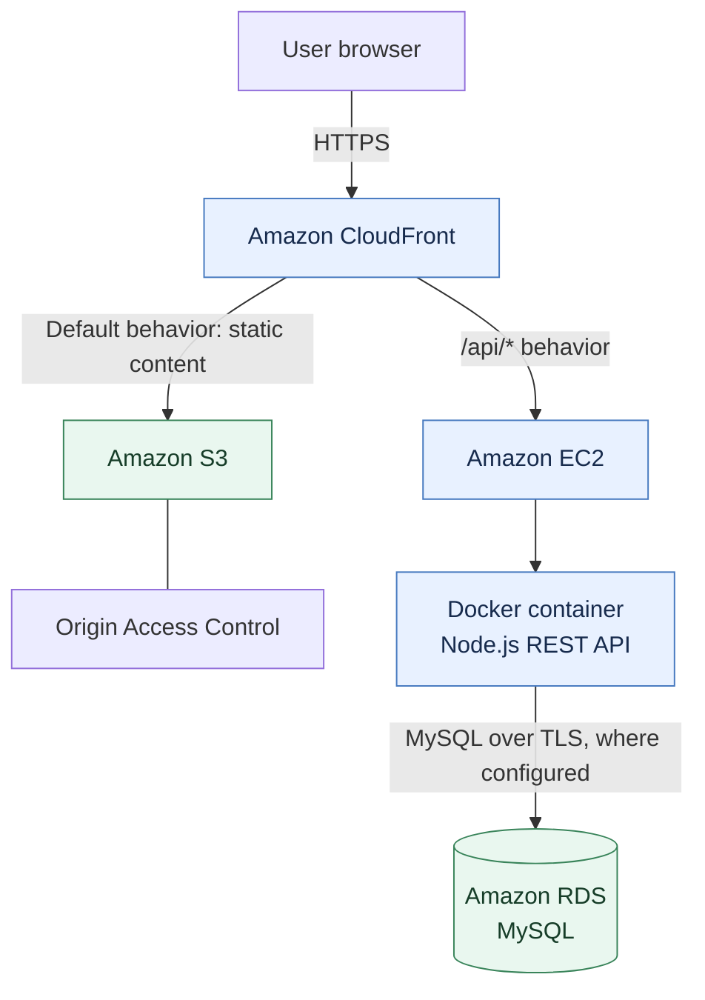

# InventoryPro — AWS Deployment & Architecture

This document describes the AWS architecture and deployment workflow for **InventoryPro**, an inventory and sales management application.

The deployment described here uses **Amazon CloudFront**, **Amazon S3**, **Amazon EC2**, **Docker**, and **Amazon RDS for MySQL**. The frontend is a React/Vite single-page application, while the Node.js backend exposes REST API endpoints.

> **Security note:** This public documentation intentionally omits passwords, JWT secrets, account-specific identifiers, database endpoints, public IP addresses, and direct infrastructure hostnames. Store sensitive configuration outside the repository. Confirm the current AWS console settings before relying on any example values below.

## Table of contents

1. [Architecture overview](#1-architecture-overview)
2. [AWS resources](#2-aws-resources)
3. [Database tier — Amazon RDS](#3-database-tier--amazon-rds)
4. [Backend tier — Amazon EC2 and Docker](#4-backend-tier--amazon-ec2-and-docker)
5. [Frontend tier — Amazon S3](#5-frontend-tier--amazon-s3)
6. [Edge routing — Amazon CloudFront](#6-edge-routing--amazon-cloudfront)
7. [Security considerations](#7-security-considerations)
8. [Engineering challenges and solutions](#8-engineering-challenges-and-solutions)
9. [Verification and maintenance](#9-verification-and-maintenance)

---

## 1. Architecture overview

InventoryPro uses a single CloudFront distribution to serve the static frontend and route API requests to the backend.



### Request flow

- Browser requests use HTTPS to reach CloudFront.
- The default CloudFront behavior routes frontend requests to the S3 origin.
- Requests matching `/api/*` are routed to the EC2 backend origin.
- The backend runs in a Docker container and communicates with the MySQL database hosted on RDS.
- The S3 bucket should remain private when using CloudFront Origin Access Control (OAC).

### Main architectural choices

**Single-domain frontend and API routing**

Serving the frontend and API through the same CloudFront distribution can avoid browser cross-origin requests when the frontend calls relative API paths such as `/api`.

**Separate frontend and backend tiers**

The built frontend is stored in S3. The Node.js API runs separately on EC2 in Docker.

**Managed relational database**

Amazon RDS provides the managed MySQL database tier, separate from the EC2 compute instance.

---

## 2. AWS resources

The deployment guide describes the following resources. Resource names and identifiers are intentionally generalized here.

| Service | Role | Configuration described in the project |
|---|---|---|
| Amazon CloudFront | CDN and request routing | Default route for frontend; `/api/*` route for backend |
| Amazon S3 | Frontend static-file storage | React/Vite production build; private bucket with OAC |
| Amazon EC2 | Backend compute | Ubuntu Server; `t3.micro` instance in the documented setup |
| Docker | Backend containerization | Node.js API container; host port 80 mapped to container port 5000 |
| Amazon RDS | Relational database | MySQL 8.0; `db.t4g.micro` / `db.t3.micro` instance class |
| VPC security groups | Network access control | SSH, HTTP/HTTPS as required, and restricted MySQL access |

The AWS region used in the deployment is **US East (N. Virginia) — `us-east-1`**. Availability Zones can differ between resources.

---

## 3. Database tier — Amazon RDS

### Database configuration

The deployment notes describe:

- Engine: MySQL Community Server 8.0
- DB identifier: `<YOUR_DB_IDENTIFIER>`
- Instance class: `db.t4g.micro` or `db.t3.micro`
- Allocated storage: 20 GiB General Purpose SSD (gp3)
- Initial database name: `retail_db`
- Port: `3306`

Do not publish the database endpoint or database credentials in this repository. Obtain the endpoint from the RDS console or your deployment environment when configuring the application.

### Network access

The RDS security group should allow inbound MySQL traffic on TCP port `3306` **only from the backend EC2 security group** (or another explicitly trusted source required for administration).

Do not expose MySQL to the public internet with a source of `0.0.0.0/0`. A strong password or TLS does not make unrestricted public database access an appropriate security configuration.

### Database initialization

Run the project's database initialization script from the backend directory after setting the required environment variables securely:

```powershell
# Set these values in your local shell or secure environment.
$env:DB_HOST = "<RDS_ENDPOINT>"
$env:DB_PORT = "3306"
$env:DB_USER = "<DB_USERNAME>"
$env:DB_PASSWORD = "<DB_PASSWORD>"
$env:DB_NAME = "retail_db"
$env:DB_SSL = "true"

cd server
node init_db.js
```

The database initialization process creates the relational tables and seeds over 160 products across several retail categories.

---

## 4. Backend tier — Amazon EC2 and Docker

### EC2 host

The configuration describes:

- AMI: Ubuntu Server 24.04 LTS
- Instance type: `t3.micro`
- Backend host port: `80`
- Docker container port: `5000`

Keep SSH (TCP `22`) restricted to trusted administrator IP addresses. Allow application traffic only as required by the chosen CloudFront-to-origin design.

### Dockerfile

The following is the multi-stage Dockerfile structure documented for the backend:

```dockerfile
FROM node:20-alpine AS deps

WORKDIR /app
COPY server/package*.json ./
RUN npm install --omit=dev

FROM node:20-alpine AS runner

WORKDIR /app
ENV NODE_ENV=production
ENV PORT=5000

RUN apk add --no-cache curl
RUN addgroup -S appgroup && adduser -S appuser -G appgroup

COPY --from=deps /app/node_modules ./node_modules
COPY server/package.json ./
COPY server/src ./src
COPY server/init_db.js ./
COPY server/seed_all_products.js ./

RUN chown -R appuser:appgroup /app
USER appuser

EXPOSE 5000

HEALTHCHECK --interval=30s --timeout=5s --start-period=15s --retries=3 \
  CMD curl -f http://localhost:5000/live || exit 1

CMD ["node", "src/index.js"]
```

### Build the Docker image

Run from the repository root:

```bash
sudo docker build -t inventorypro-backend -f server/Dockerfile .
```

### Configure runtime environment securely

Create an environment file on the EC2 host outside the Git repository, for example:

`/opt/inventorypro/.env`

Populate it on the server with the actual values from your secure configuration store. Do not commit this file or paste real secrets into documentation.

Example structure (placeholders only):

```dotenv
PORT=5000
NODE_ENV=production
JWT_SECRET=<GENERATE_A_LONG_RANDOM_SECRET>
DB_HOST=<RDS_ENDPOINT>
DB_PORT=3306
DB_USER=<DB_USERNAME>
DB_PASSWORD=<DB_PASSWORD>
DB_NAME=retail_db
DB_SSL=true
CORS_ORIGIN=<EXPECTED_ORIGIN_OR_CONFIGURATION>
```

Restrict access to the file:

```bash
sudo chown root:root /opt/inventorypro/.env
sudo chmod 600 /opt/inventorypro/.env
```

For production environments, prefer a managed secrets solution such as AWS Secrets Manager or Systems Manager Parameter Store, with an IAM role granting only the required access.

### Run the container

```bash
sudo docker run -d \
  --name inventorypro-api \
  --restart unless-stopped \
  --env-file /opt/inventorypro/.env \
  -p 80:5000 \
  inventorypro-backend
```

The mapping `80:5000` publishes host port 80 and forwards traffic to port 5000 inside the container.

### Backend health check

The backend implements `/health` and the Dockerfile health check uses `/live`:

```bash
curl http://localhost/health
```

Do not publish real health-check responses if they reveal internal hostnames, database details, environment information, or other sensitive data.

---

## 5. Frontend tier — Amazon S3

### Bucket configuration

The deployment uses an S3 general-purpose bucket in `us-east-1`, with all four Block Public Access settings enabled and CloudFront OAC used to access the bucket.

Keep the actual bucket name in your private deployment configuration if it contains account-identifying information.

### Build the React application

```bash
cd client
npm install
npm run build
```

The Vite production build is generated in:

```text
client/dist/
```

The build output typically includes `index.html` and the generated assets directory.

### Upload the build to S3

Replace `<S3_BUCKET_NAME>` with the bucket configured for the deployment:

```bash
aws s3 sync client/dist s3://<S3_BUCKET_NAME> --delete
```

The `--delete` option removes destination objects that are no longer present in the local build directory. Use it only when the bucket/prefix is dedicated to this frontend deployment.

---

## 6. Edge routing — Amazon CloudFront

CloudFront is configured as the public entry point for the frontend and API.

### Origins

| Origin | Purpose | Access pattern |
|---|---|---|
| S3 REST origin | React/Vite static frontend | CloudFront Origin Access Control (OAC) |
| EC2 backend origin | Node.js REST API | CloudFront forwards matching API requests to the backend |

### Cache behaviors

The architecture configures two behaviors:

#### API behavior: `/api/*`

- Origin: EC2 backend
- Viewer protocol policy: Redirect HTTP to HTTPS
- Allowed methods: `GET`, `HEAD`, `OPTIONS`, `PUT`, `POST`, `PATCH`, `DELETE`
- Cache policy: Managed caching disabled, so dynamic API responses are not cached
- Origin request policy: forwards the required viewer headers, cookies, and query strings while excluding the viewer `Host` header (`Managed-AllViewerExceptHostHeader`)

#### Default behavior: `*`

- Origin: S3 REST origin
- Viewer protocol policy: Redirect HTTP to HTTPS
- Allowed methods: `GET`, `HEAD`
- Cache policy: Managed caching optimized for static content

For a single-page application, configure and test the required fallback behavior for client-side routes. Ensure that API errors are not rewritten as the frontend's `index.html`.

### Invalidate cached frontend assets

After uploading a new frontend build, invalidate CloudFront paths if needed:

```bash
aws cloudfront create-invalidation \
  --distribution-id <CLOUDFRONT_DISTRIBUTION_ID> \
  --paths "/*"
```

---

## 7. Security considerations

Apply and periodically review these controls:

1. **S3 Origin Access Control:** Keep S3 Block Public Access enabled and allow CloudFront to access the bucket through OAC.
2. **RDS network restriction:** Permit inbound TCP `3306` only from the backend security group or another narrowly scoped trusted source.
3. **SSH restriction:** Limit TCP `22` to trusted administrator IP addresses. Do not leave SSH open to the world.
4. **Secrets management:** Never hardcode database passwords, JWT secrets, access keys, or private keys in source code, Docker commands, screenshots, or README files.
5. **Database transport encryption:** Enable and verify TLS for connections between the backend and RDS.
6. **JWT security:** Use a strong randomly generated signing secret, appropriate token expiry, and server-side authorization checks.
7. **Container privileges:** Run the application as a non-root user inside the container.
8. **Least-privilege IAM:** Grant EC2 and deployment identities only the permissions they need.
9. **HTTPS:** Use HTTPS for browser-facing traffic and verify the CloudFront viewer protocol policy.
10. **Repository hygiene:** Keep `.env`, private keys, database dumps containing real user data, and credentials out of Git.

---

## 8. Engineering challenges and solutions

### 8.1 Mixed-content requests

**Challenge:** The frontend was loaded over HTTPS while API requests initially targeted an HTTP backend endpoint. Browsers can block insecure requests from a secure page.

**Solution:** Route `/api/*` through CloudFront to the EC2 backend. The browser communicates with CloudFront over HTTPS, avoiding direct browser requests to an HTTP API origin.

### 8.2 SPA fallback and API error responses

**Challenge:** A single-page application may need a fallback to `index.html` for client-side routes. If API error responses are caught by the same fallback behavior, the frontend may receive HTML where it expects JSON.

**Solution:** Return an appropriate authentication error status (such as HTTP `401` for invalid credentials) and ensure CloudFront's SPA fallback configuration does not rewrite API responses.

### 8.3 Docker build context and dependency files

**Challenge:** The backend dependency manifest and lockfile are located under the `server/` directory, while the Docker build is launched from the repository root.

**Solution:** Copy the backend package manifests from the correct build-context path in the Dockerfile and install production dependencies in the image.

---

## 9. Verification and maintenance

### Verify the backend

Run a health check against the backend from the EC2 host:

```bash
curl http://localhost/health
```

### Verify the CloudFront route

Replace `<CLOUDFRONT_DOMAIN>` with the current distribution domain:

```bash
curl https://<CLOUDFRONT_DOMAIN>/api/health
```

### Update the backend

A typical update sequence on the EC2 host is:

```bash
cd ~/app
git pull origin main
sudo docker build -t inventorypro-backend -f server/Dockerfile .
sudo docker rm -f inventorypro-api
sudo docker run -d \
  --name inventorypro-api \
  --restart unless-stopped \
  --env-file /opt/inventorypro/.env \
  -p 80:5000 \
  inventorypro-backend
```

### Update the frontend

```bash
cd client
npm run build
aws s3 sync dist s3://<S3_BUCKET_NAME> --delete

aws cloudfront create-invalidation \
  --distribution-id <CLOUDFRONT_DISTRIBUTION_ID> \
  --paths "/*"
```

